# คู่มือการใช้งาน — Netflix Data Explorer

ระบบจัดการและวิเคราะห์ข้อมูลยอดดู Netflix (What We Watched, ม.ค.–มิ.ย. 2026)
ข้อมูลไหลครบวงจร: **หน้าเว็บ ↔ MySQL ↔ Excel → Tableau → หน้าเว็บ**

> ภาพหน้าจอทั้งหมดในคู่มือนี้ถ่ายจากระบบจริง (ไฟล์อยู่ใน `docs/images/`)

---

## สารบัญ

1. ภาพรวมระบบ
2. ชุดข้อมูลที่นำมาใช้ และแหล่งที่มา
3. ติดตั้งและเปิดโปรแกรม
4. หน้าภาพรวม (ค่าที่คำนวณได้)
5. จัดการข้อมูล: ค้นหา / เพิ่ม / แก้ไข / ลบ
6. แก้ข้อมูลในไฟล์ Excel โดยตรง
7. หน้าซิงก์ Excel
8. ทำกราฟใน Tableau และแสดงบนเว็บ
9. Source code ของโปรแกรม
10. ลำดับขั้นตอนสาธิต (สำหรับนำเสนอ)
11. ปัญหาที่พบบ่อย

---

## 1. ภาพรวมระบบ

ข้อมูลไหลตามลำดับนี้

| ขั้น | จาก | ไปที่ | เกิดอะไรขึ้น |
|---|---|---|---|
| 1 | หน้าเว็บ (React) | Backend Go + MySQL | ผู้ใช้เพิ่ม / แก้ / ลบข้อมูล → บันทึกลงตาราง `titles` |
| 2 | Backend Go | Excel `netflix_data.xlsx` | เขียน sheet1 (ข้อมูลดิบ) ใหม่ แล้วให้ Excel คำนวณสูตร sheet2–4 ใหม่ |
| 3 | Excel | Backend Go + MySQL | ถ้าแก้ไฟล์ Excel โดยตรง ระบบตรวจไฟล์ทุก 3 วินาที แล้วนำเข้าฐานข้อมูล |
| 4 | Excel (sheet1 + sheet4) | Tableau | Tableau อ่านข้อมูลดิบและค่าที่ Excel คำนวณ มาทำกราฟ → publish ขึ้น Tableau Public |
| 5 | Tableau Public | หน้าเว็บ | ฝัง Dashboard ในเมนู **กราฟ Tableau** (และภาพนิ่งสำรอง) |
| 6 | Backend Go | หน้าเว็บ | แสดงข้อมูลและค่าที่คำนวณได้ในเมนู **ภาพรวม** |

ไฟล์ Excel มี 4 sheet: **sheet1** ข้อมูลดิบ · **sheet2** วิเคราะห์ด้วยสูตร · **sheet3** Top 10 · **sheet4** สรุปสำหรับ Tableau

| ส่วนประกอบ | หน้าที่ |
|---|---|
| หน้าเว็บ (React) | ป้อน/แก้/ลบข้อมูล, แสดงค่าที่คำนวณได้, ฝังกราฟ Tableau, ซิงก์ไฟล์ |
| Backend (Go) | REST API, บันทึกลง MySQL, ซิงก์กับ Excel สองทาง |
| MySQL | ฐานข้อมูลหลัก ตาราง `titles` |
| Excel | ข้อมูลดิบ + วิเคราะห์ด้วยสูตร (ค่าเฉลี่ย, มัธยฐาน, %, Top 10, Pareto) |
| Tableau | ทำกราฟจากข้อมูลดิบและค่าที่ Excel คำนวณ |

---

## 2. ชุดข้อมูลที่นำมาใช้ และแหล่งที่มา

### 2.1 แหล่งที่มา

| รายการ | รายละเอียด |
|---|---|
| ชื่อชุดข้อมูล | *What We Watched: A Netflix Engagement Report (January–June 2026)* |
| ผู้จัดทำ / เผยแพร่ | Netflix (เผยแพร่ 16 กรกฎาคม 2026) |
| แหล่งที่มา (URL) | https://about.netflix.com/en/news/what-we-watched-the-first-half-of-2026 |
| ช่วงเวลาของข้อมูล | ยอดดูทั่วโลก 1 มกราคม – 30 มิถุนายน 2026 |
| ไฟล์ต้นฉบับ | `source/Netflix_What_We_Watched_2026Jan-Jun_original.xlsx` (ดาวน์โหลดจากหน้าเว็บด้านบน ไม่ได้แก้ไข) |
| รูปแบบต้นฉบับ | Excel 2 sheet: `Shows` (ซีรีส์ 8,193 เรื่อง) และ `Movies` (ภาพยนตร์ 9,177 เรื่อง) |
| จำนวนข้อมูลที่ใช้ | **17,370 เรื่อง** (TV 8,193 + Film 9,177) |

อ้างอิง: Netflix. (2026, July 16). *What We Watched: A Netflix Engagement Report (January–June 2026)*. https://about.netflix.com/en/news/what-we-watched-the-first-half-of-2026

### 2.2 คอลัมน์ของข้อมูล (sheet1_RawData)

| คอลัมน์ | ความหมาย | ที่มา |
|---|---|---|
| ID | รหัสแถว (ระบบสร้างให้) | เพิ่มเอง |
| Type | `TV` (จาก sheet Shows) หรือ `Film` (จาก sheet Movies) | เพิ่มเอง |
| Title | ชื่อเรื่อง (ซีรีส์แยกตามซีซัน) | ต้นฉบับ |
| Available Globally | ฉายทุกประเทศหรือไม่ (`Yes` / `No`) | ต้นฉบับ |
| Release Date | วันที่ออกฉายบน Netflix (Netflix ใส่ให้เฉพาะคอนเทนต์ของ Netflix) | ต้นฉบับ |
| Hours Viewed | ชั่วโมงดูรวมทั่วโลก (ปัดเป็นหลักแสน) | ต้นฉบับ |
| Runtime | ความยาว `ชั่วโมง:นาที` (ซีรีส์ = ความยาวทั้งซีซัน) | ต้นฉบับ |
| Runtime (Hours) | Runtime แปลงเป็นทศนิยม เช่น `1:30` → `1.50` | คำนวณเพิ่ม |
| Views | ยอดวิว = Hours Viewed ÷ Runtime (นิยามของ Netflix, ปัดเป็นหลักแสน) | ต้นฉบับ |

### 2.3 การเตรียมข้อมูล (Data cleaning)

ทำด้วยสคริปต์ `scripts/build_excel.py` (Python + openpyxl) ได้ไฟล์ `data/netflix_data.xlsx`

| ขั้นตอน | เหตุผล |
|---|---|
| ตัดหัวรายงาน 5 แถวแรก เริ่มอ่านใต้แถวชื่อคอลัมน์ | ต้นฉบับมีชื่อรายงานและหมายเหตุอยู่ด้านบน |
| เพิ่มคอลัมน์ `Type` แล้วรวม 2 sheet เป็นตารางเดียว | วิเคราะห์ TV กับ Film เทียบกันได้ |
| ตัดแถว "Other Shows" และ "Other Movies" | เป็นยอดรวมของเรื่องที่ยอดดูต่ำกว่า 50,000 ไม่ใช่เรื่องจริง จะทำให้ค่าเฉลี่ยเพี้ยน |
| ตัด footnote และแถวว่างท้าย sheet | ไม่ใช่ข้อมูล |
| Runtime: ลบเครื่องหมาย `*` (เช่น `1:02*` = รายการสด) ถ้าว่างให้เป็นค่าว่าง | ให้เป็นรูปแบบเดียวกันทั้งคอลัมน์ |
| Release Date: แปลงข้อความ `YYYY-MM-DD` เป็นวันที่ของ Excel | ใช้คำนวณตามปีได้ |

ข้อสังเกตของข้อมูล: Release Date ว่าง 11,324 เรื่อง, Runtime ว่าง 193 เรื่อง (ส่วนใหญ่เป็นรายการสด/กีฬา)
ข้อมูลไม่มีคอลัมน์บอกว่าเป็นคอนเทนต์ของ Netflix เองหรือไม่ จึงใช้เกณฑ์ **มี Release Date = Netflix Title** แทน (Netflix ระบุวันที่ให้เฉพาะคอนเทนต์ของ Netflix)

### 2.4 การวิเคราะห์ใน Excel (sheet2–4)

ตั้งชื่อช่วงข้อมูล (Named Range) เช่น `D_Type`, `D_Views`, `D_Hours` ชี้ไปที่ `sheet1_RawData` ถึงแถว 100,000 เพื่อให้สูตรอัปเดตเองเมื่อเพิ่มแถว

| หัวข้อ (sheet2_Analysis) | ตัวอย่างสูตร |
|---|---|
| KPI ภาพรวม | `=COUNTA(D_Title)`, `=SUM(D_Views)`, `=AVERAGE(D_Views)`, `=MEDIAN(D_Views)`, `=STDEV(D_Views)` |
| TV กับ Film | `=COUNTIF(D_Type,B16)`, `=SUMIF(D_Type,B16,D_Hours)`, `=AVERAGEIF(D_Type,B16,D_Views)`, `=MEDIAN(IF(D_Type=B16,D_Views))` |
| Netflix Title กับ Non-Netflix | `=COUNTIFS(D_Title,"<>",D_Rel,"<>")`, `=AVERAGEIFS(D_Views,D_Title,"<>",D_Rel,"<>")` |
| ฉายทั่วโลก Yes/No | `=AVERAGEIF(D_Global,B28,D_Views)` |
| ช่วงความยาว, ปีที่ออกฉาย, Pareto (Top x% ครองชั่วโมงดูกี่ %) | `COUNTIFS`, `SUMIFS`, `LARGE`, `ROUNDUP` |
| Top 10 Film / TV (sheet3_Top10) | `LARGE`, `INDEX`, `SMALL(IF(...))` |

`sheet4_TableauSummary` ดึงค่าจาก sheet2–3 มาเรียงเป็นตาราง `Section / Group / Metric / Value` ให้ Tableau นำไปทำกราฟ

**ผลวิเคราะห์ที่น่าสนใจ**
- TV มีจำนวนเรื่องน้อยกว่า Film แต่ครองชั่วโมงดู **76%**
- Netflix Title ได้ยอดดูเฉลี่ย 1.93 ล้าน เกือบ 2 เท่าของ Non-Netflix (1.04 ล้าน)
- เรื่องท็อป **1% (174 เรื่อง) ครองชั่วโมงดู 25%** และท็อป 10% ครอง 68%
- ค่าเฉลี่ยยอดดู (1.35 ล้าน) สูงกว่ามัธยฐาน (300,000) มาก แสดงว่าข้อมูลเบ้ขวา มีเรื่องดังไม่กี่เรื่องดึงค่าเฉลี่ยขึ้น

---

## 3. ติดตั้งและเปิดโปรแกรม

### วิธีที่ 1: Docker (แนะนำ — คำสั่งเดียวได้ทั้งระบบ)

1. ติดตั้ง **Docker Desktop**: https://www.docker.com/products/docker-desktop/ แล้วเปิดโปรแกรมทิ้งไว้
2. เปิด Terminal (Windows: PowerShell) ที่โฟลเดอร์โปรเจกต์ แล้วรัน
   ```
   docker compose up --build
   ```
   ครั้งแรกใช้เวลา 3–10 นาที (ดาวน์โหลด MySQL, Go, Node, LibreOffice)
3. เมื่อเห็นข้อความ `เปิดเว็บที่ http://localhost:8080` ให้เปิดเบราว์เซอร์ไปที่ **http://localhost:8080**
4. ปิดระบบ: กด `Ctrl + C` ใน Terminal (หรือ `docker compose down`)

ไฟล์ Excel ที่ระบบใช้คือ `data/netflix_data.xlsx` ในโฟลเดอร์โปรเจกต์ เปิดด้วย Excel ได้ตามปกติ

### วิธีที่ 2: รันเองโดยไม่ใช้ Docker

ต้องมี: MySQL 8, Go 1.23+, Node.js 20+ (และ LibreOffice ถ้าต้องการให้คำนวณสูตรอัตโนมัติ)

1. สร้างฐานข้อมูลใน MySQL
   ```sql
   CREATE DATABASE netflix CHARACTER SET utf8mb4;
   CREATE USER 'netflix'@'localhost' IDENTIFIED BY 'netflix';
   GRANT ALL ON netflix.* TO 'netflix'@'localhost';
   ```
2. Build หน้าเว็บ
   ```
   cd frontend
   npm install
   npm run build
   ```
3. รัน backend (Windows PowerShell)
   ```
   cd backend
   go mod tidy
   $env:STATIC_DIR="../frontend/dist"; $env:EXCEL_PATH="../data/netflix_data.xlsx"; go run .
   ```
   macOS/Linux: `STATIC_DIR=../frontend/dist EXCEL_PATH=../data/netflix_data.xlsx go run .`
4. เปิด http://localhost:8080

ตัวแปรที่ตั้งได้: `DB_DSN` (ค่าเริ่มต้น `netflix:netflix@tcp(127.0.0.1:3306)/netflix?charset=utf8mb4`), `PORT`, `POLL_SECONDS`,
`RECALC` (`auto`/`true`/`false`), `SOFFICE_PATH` (เช่น `C:\Program Files\LibreOffice\program\soffice.exe`)

> ครั้งแรกที่เปิด ระบบจะนำเข้าข้อมูล 17,370 แถวจาก Excel ลง MySQL ให้อัตโนมัติ

---

## 4. หน้าภาพรวม (ค่าที่คำนวณได้)

เมนู **ภาพรวม** แสดงผลวิเคราะห์ชุดเดียวกับ `sheet2_Analysis` ใน Excel

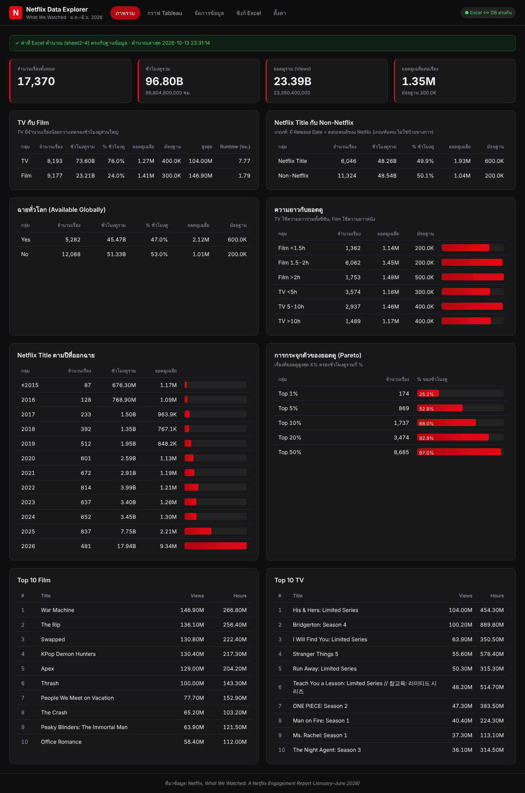

| ส่วน | ความหมาย |
|---|---|
| แถบสีเขียวด้านบน | ยืนยันว่าค่าที่ Excel คำนวณ (sheet2–4) ตรงกับฐานข้อมูล ถ้าเป็นสีเหลือง = Excel กำลังคำนวณใหม่ |
| การ์ด KPI 4 ใบ | จำนวนเรื่อง, ชั่วโมงดูรวม, ยอดดูรวม, ยอดดูเฉลี่ย/มัธยฐาน |
| TV กับ Film | จำนวน, ชั่วโมงดู, % ชั่วโมงดู, ยอดดูเฉลี่ย/มัธยฐาน/สูงสุด, Runtime เฉลี่ย |
| Netflix Title กับ Non-Netflix | แยกตามว่ามี Release Date หรือไม่ |
| ฉายทั่วโลก | เปรียบเทียบ Available Globally Yes/No |
| ความยาวกับยอดดู | ยอดดูเฉลี่ยตามช่วงความยาว |
| ปีที่ออกฉาย | จำนวนเรื่องและชั่วโมงดูของ Netflix Title แต่ละปี |
| Pareto | เรื่องท็อป X% ครองชั่วโมงดูกี่ % |
| Top 10 Film / TV | 10 อันดับยอดดูสูงสุด |

ค่าบนหน้านี้อัปเดตเองทุกครั้งที่ข้อมูลเปลี่ยน (ไม่ต้องกดรีเฟรช)

---

## 5. จัดการข้อมูล: ค้นหา / เพิ่ม / แก้ไข / ลบ

### 5.1 ดูและค้นหาข้อมูล

เมนู **จัดการข้อมูล** แสดงตารางข้อมูลทั้งหมด ครั้งละ 25 แถว

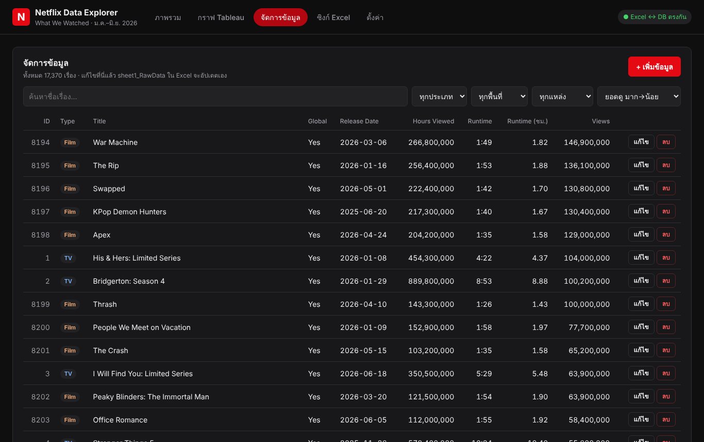

- **ช่องค้นหา**: พิมพ์บางส่วนของชื่อเรื่อง ผลจะกรองทันที
- **ตัวกรอง**: ประเภท (TV/Film), พื้นที่ฉาย, แหล่ง (Netflix Title/Non-Netflix)
- **เรียงลำดับ**: ยอดดู, ชั่วโมงดู, วันที่ออกฉาย, ชื่อ, แก้ไขล่าสุด
- ปุ่ม « ‹ › » ด้านล่างใช้เปลี่ยนหน้า

ตัวอย่างค้นหาคำว่า `Squid Game`:

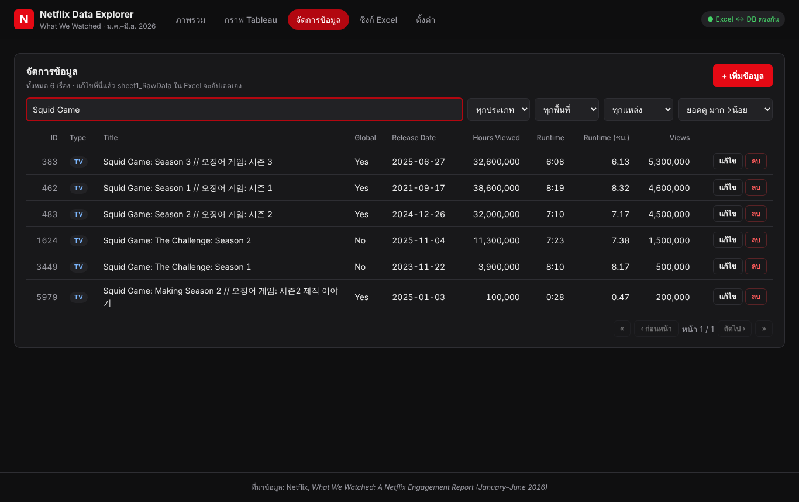

### 5.2 เพิ่มข้อมูลใหม่

1. กดปุ่ม **+ เพิ่มข้อมูล** (มุมขวาบน)
2. กรอกข้อมูล (ช่องที่มี * ต้องกรอก)
   - **Title**: ชื่อเรื่อง
   - **Type**: TV หรือ Film
   - **Available Globally**: Yes / No
   - **Release Date**: วันที่ออกฉาย (ปล่อยว่างได้ถ้าไม่ใช่คอนเทนต์ของ Netflix)
   - **Runtime**: ความยาวรูปแบบ `ชั่วโมง:นาที` เช่น `1:45`
   - **Hours Viewed**, **Views**: ตัวเลข
3. กด **บันทึก**

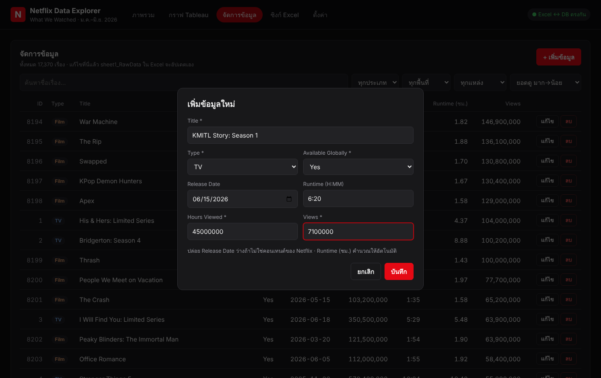

ระบบจะ: บันทึกลง MySQL → แจ้งผลเป็นแถบสีเขียว → เขียนแถวใหม่ลง `sheet1_RawData` ใน Excel → คำนวณสูตรใหม่
(คอลัมน์ `Runtime (ชม.)` คำนวณให้อัตโนมัติ)

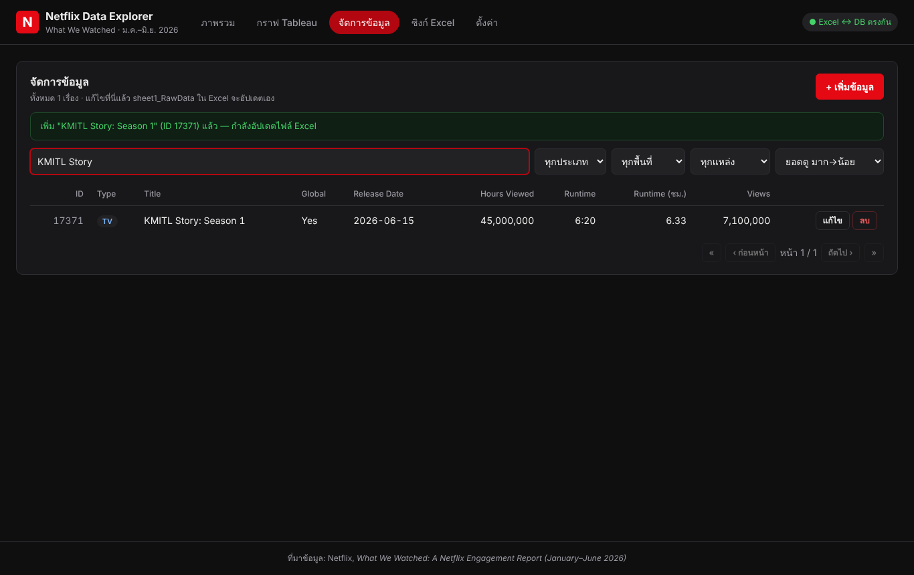

ถ้ากรอกผิด เช่น ไม่ใส่ชื่อ หรือ Runtime ไม่ใช่รูปแบบ H:MM ระบบจะแจ้งเตือนสีแดงและยังไม่บันทึก

### 5.3 แก้ไขข้อมูล

1. กดปุ่ม **แก้ไข** ท้ายแถวที่ต้องการ
2. แก้ค่าในฟอร์ม แล้วกด **บันทึก**

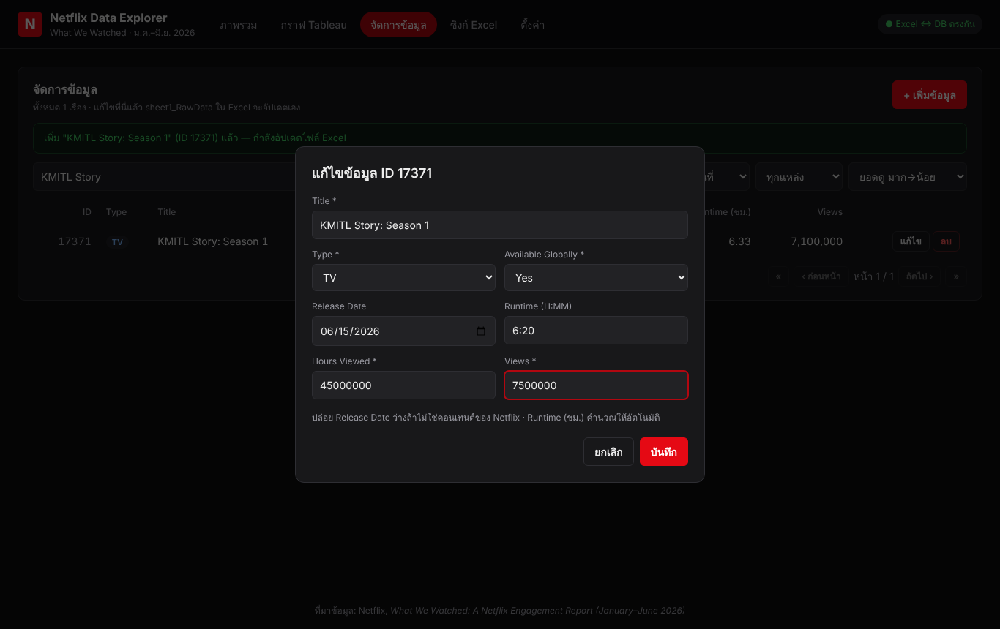

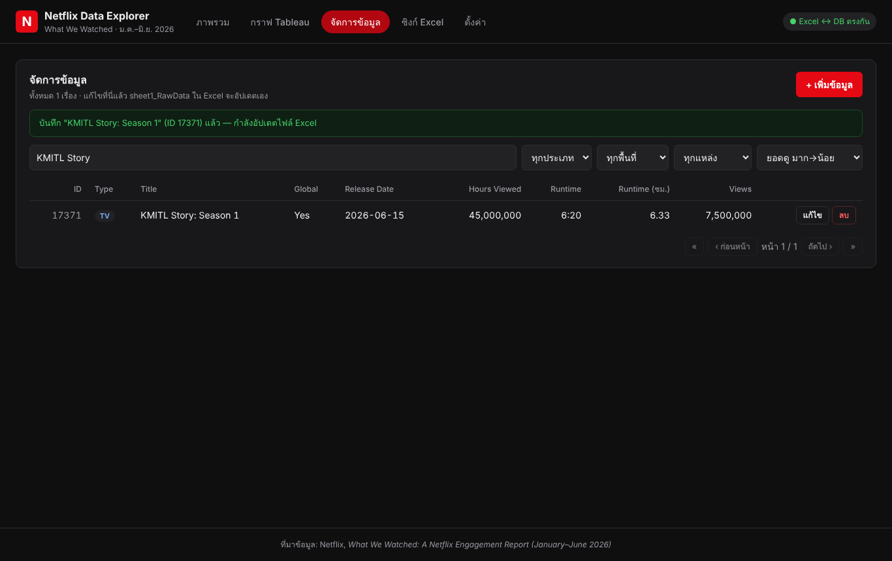

### 5.4 ลบข้อมูล

1. กดปุ่ม **ลบ** ท้ายแถว
2. กด **OK** ในกล่องยืนยัน → แถวถูกลบจากทั้ง MySQL และ Excel

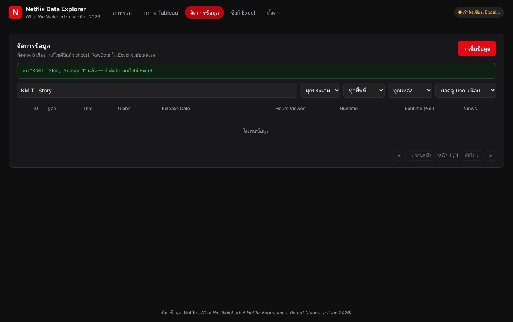

---

## 6. แก้ข้อมูลในไฟล์ Excel โดยตรง

นอกจากหน้าเว็บ สามารถแก้ใน Excel ได้เลย ระบบจะดึงเข้าฐานข้อมูลเอง

1. เปิด `data/netflix_data.xlsx` ด้วย Microsoft Excel
2. ไปที่ sheet **`sheet1_RawData`** แล้ว
   - **แก้ค่า**: แก้ในช่องได้เลย (ห้ามแก้คอลัมน์ `ID`)
   - **เพิ่มแถว**: พิมพ์ต่อท้ายตาราง **ปล่อย `ID` ว่าง** — ระบบจะใส่ ID ให้
   - **ลบแถว**: คลิกขวาที่เลขแถว → Delete
3. กด **Save** (Ctrl + S) → ภายใน 3 วินาทีฐานข้อมูลและหน้าเว็บจะอัปเดต
4. **ปิดไฟล์ Excel** เมื่อแก้เสร็จ (บน Windows ถ้าเปิดไฟล์ค้างไว้ ระบบจะเขียนไฟล์ไม่ได้จนกว่าจะปิด — ระบบจะลองใหม่ให้เอง)

กฎของแต่ละคอลัมน์

| คอลัมน์ | ค่าที่ใส่ได้ |
|---|---|
| ID | ปล่อยว่างสำหรับแถวใหม่ (ห้ามซ้ำ) |
| Type | `TV` หรือ `Film` |
| Title | ข้อความ ห้ามว่าง |
| Available Globally | `Yes` หรือ `No` |
| Release Date | วันที่ หรือว่าง |
| Hours Viewed, Views | ตัวเลข ≥ 0 |
| Runtime | `H:MM` เช่น `1:45` หรือว่าง |
| Runtime (Hours) | ไม่ต้องกรอก ระบบคำนวณเอง |

sheet อื่นๆ ใน Excel

| Sheet | ใช้ทำอะไร |
|---|---|
| `sheet2_Analysis` | ผลวิเคราะห์ 7 หัวข้อด้วยสูตร Excel (COUNTIF, SUMIF, AVERAGEIF, MEDIAN, LARGE ฯลฯ) — อัปเดตเองเมื่อข้อมูลเปลี่ยน |
| `sheet3_Top10` | Top 10 Film และ TV ด้วยสูตร |
| `sheet4_TableauSummary` | ค่าจาก sheet2–3 ในรูปตารางสำหรับ Tableau |

> **ระบบกันข้อมูลหาย**: ถ้าบันทึกไฟล์ที่ข้อมูลหายไปเกินครึ่ง (เช่นเผลอลบทั้งตาราง) ระบบจะ**ไม่**นำเข้า และแจ้งเตือนในหน้าซิงก์
> แถวที่ข้อมูลผิดรูปแบบจะไม่ถูกนำเข้า และแสดงเลขแถว + สาเหตุในหน้าซิงก์

---

## 7. หน้าซิงก์ Excel

เมนู **ซิงก์ Excel** ใช้ดูสถานะการเชื่อม Excel กับ MySQL และสั่งงานด้วยมือ

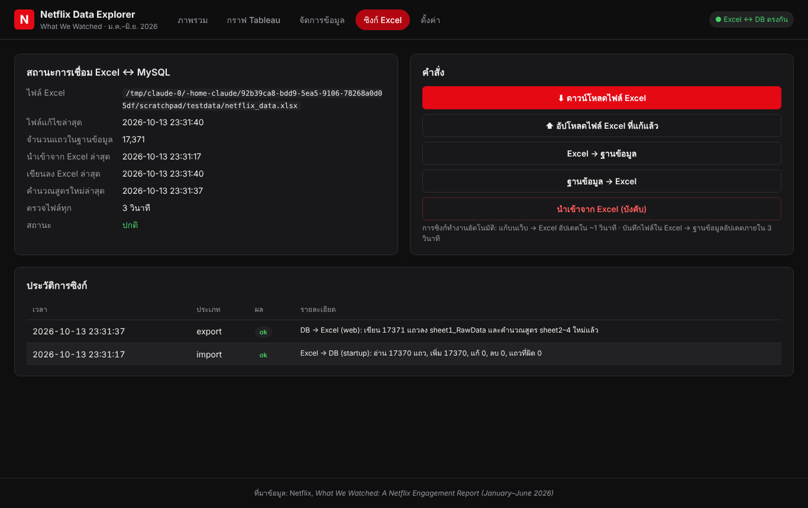

| ปุ่ม | ทำอะไร |
|---|---|
| ⬇ ดาวน์โหลดไฟล์ Excel | ดาวน์โหลดไฟล์ล่าสุด (มีครบ 4 sheet) |
| ⬆ อัปโหลดไฟล์ Excel ที่แก้แล้ว | นำเข้าข้อมูลจาก sheet1 ของไฟล์ที่อัปโหลด (sheet วิเคราะห์ของไฟล์หลักยังอยู่ครบ) |
| Excel → ฐานข้อมูล | ดึงข้อมูลจาก Excel เข้า MySQL ทันที |
| ฐานข้อมูล → Excel | เขียนข้อมูลจาก MySQL ลง Excel ทันที |
| นำเข้าจาก Excel (บังคับ) | ใช้เมื่อตั้งใจลบข้อมูลจำนวนมากใน Excel จริงๆ |

ป้ายมุมขวาบนของทุกหน้าบอกสถานะ: 🟢 ตรงกัน · 🟡 กำลังเขียน Excel · 🔴 มีปัญหา (กดเพื่อดูรายละเอียด)

ตาราง **ประวัติการซิงก์** บันทึกทุกครั้งที่ข้อมูลเคลื่อนระหว่าง Excel กับฐานข้อมูล พร้อมจำนวนแถวที่เพิ่ม/แก้/ลบ

---

## 8. ทำกราฟใน Tableau และแสดงบนเว็บ

ไฟล์ Tableau ของโปรเจกต์คือ **`data/tableau_netflix2.twbx`** (ขั้นตอนทำกราฟละเอียดอยู่ใน `tableau/TABLEAU_GUIDE.md`)

**tableau_netflix2 ประกอบด้วย**

| Dashboard | Worksheet | แหล่งข้อมูล |
|---|---|---|
| `Dashboard_Overview` | 01_KPI, 02_TV_Film_Share, 03_AVG_MED, 04_Origin_AvgViews, 04_Origin_HoursShare, 05_Global_AvgViews, 05_Global_HoursShare, 06_Runtime_Views, 07_Release_Year, 07_Release_Year_Titles, 08_Pareto | `sheet4_TableauSummary` (ค่าที่ Excel คำนวณใน sheet2–3) |
| `Dashboard_Details` | 09_Top10_Film, 09_Top10_TV, 10_Runtime_Scatter | `sheet1_RawData` (ข้อมูลดิบ) |

**การแสดงกราฟบนเว็บ (เมนู กราฟ Tableau)** — Dashboard publish ขึ้น Tableau Public แล้ว หน้าเว็บแสดงได้ 2 แบบ คือ **ฝังแบบโต้ตอบได้** (ต้องมีอินเทอร์เน็ต) และ **ภาพนิ่ง** (ใช้ได้แม้ออฟไลน์) รวม 4 แท็บ:

| แท็บ | แสดงอะไร | ต้องมีอินเทอร์เน็ต |
|---|---|---|
| ภาพรวม (Tableau) | Dashboard_Overview แบบโต้ตอบได้ (ชี้เมาส์ดูค่า, คลิกกรอง) | ใช่ |
| Top 10 และ Runtime (Tableau) | Dashboard_Details แบบโต้ตอบได้ | ใช่ |
| Dashboard Overview (ภาพ) | ภาพนิ่งจาก `data/tableau/01_Dashboard_Overview.png` | ไม่ |
| Dashboard Details (ภาพ) | ภาพนิ่งจาก `data/tableau/02_Dashboard_Details.png` | ไม่ |

ลิงก์ที่ publish ไว้:
- https://public.tableau.com/views/tableau_netflix2/Dashboard_Overview
- https://public.tableau.com/views/tableau_netflix2/Dashboard_Details

**เพิ่ม/เปลี่ยนลิงก์:** เมนู **ตั้งค่า** → **+ เพิ่มลิงก์** → ใส่ชื่อแท็บและวางลิงก์จากปุ่ม **Share** ของ Tableau Public → **บันทึก**

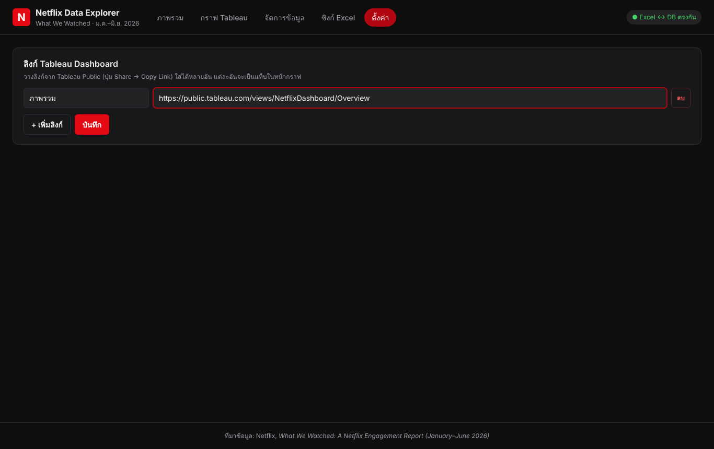

**อัปเดตภาพนิ่งเมื่อข้อมูลเปลี่ยน:** Tableau Public ไม่มีเมนู Export Image → หลัง Save to Tableau Public แล้ว
เปิด `https://public.tableau.com/views/tableau_netflix2/Dashboard_Overview.png?:display_static_image=y` ในเบราว์เซอร์ → บันทึกภาพทับ `data/tableau/01_Dashboard_Overview.png`
(ทำแบบเดียวกันกับ `Dashboard_Details` → `02_Dashboard_Details.png`)

หน้ากราฟมีปุ่ม **ดาวน์โหลด tableau_netflix2.twbx** ให้ผู้ใช้โหลดไฟล์ Tableau ไปเปิดเองได้

หน้า **กราฟ Tableau** บนเว็บ แท็บ "ภาพรวม (Tableau)" ฝัง Dashboard จาก Tableau Public (เลื่อนดู / ชี้เมาส์ดูค่า / สลับ sheet ด้านบนได้):

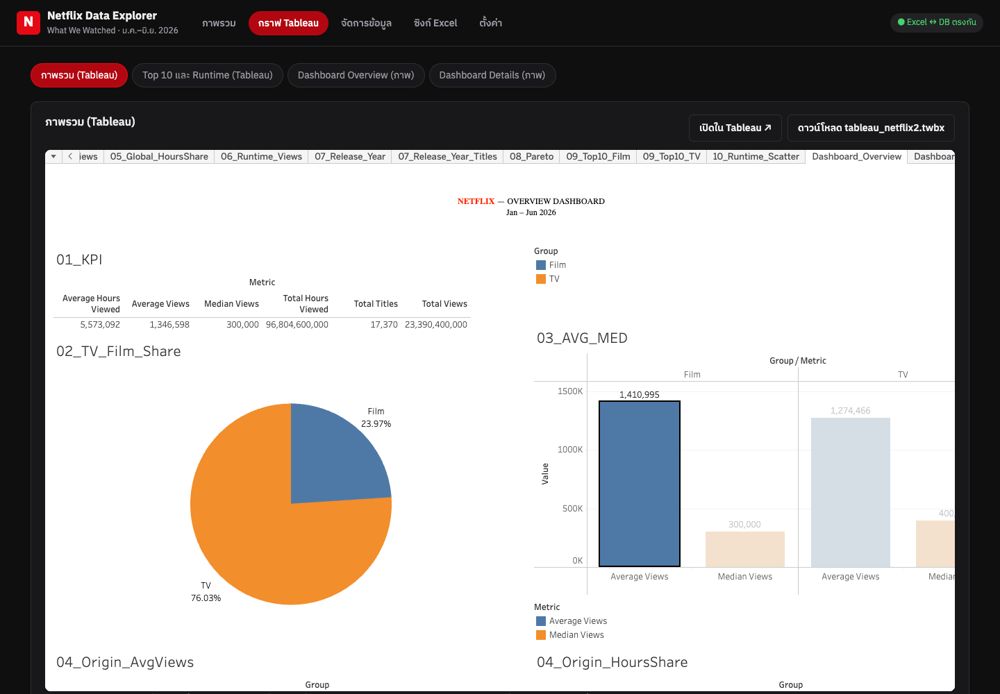

แท็บ "Dashboard Overview (ภาพ)" แสดงภาพนิ่ง ใช้ได้แม้ไม่มีอินเทอร์เน็ต:

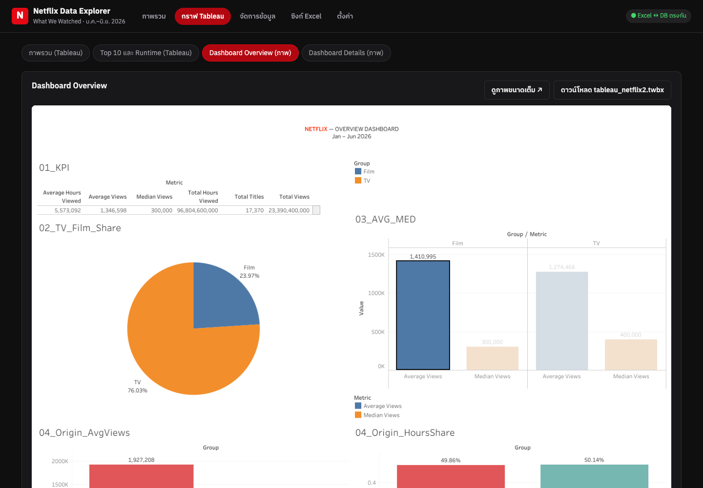

**Dashboard_Overview** (tableau_netflix2) — KPI, สัดส่วน TV/Film, ค่าเฉลี่ย vs มัธยฐาน, Netflix Title vs Non-Netflix, ฉายทั่วโลก, ความยาว, ปีที่ออกฉาย, Pareto
(ข้อมูลจาก `sheet4_TableauSummary` = ค่าที่ Excel คำนวณใน sheet2–3)

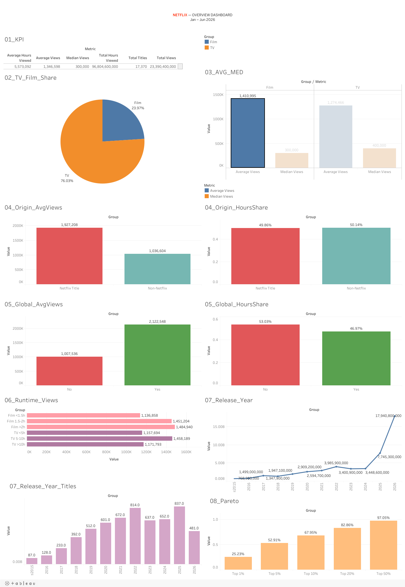

**Dashboard_Details** (tableau_netflix2) — Top 10 Film, Top 10 TV, Runtime กับยอดดู (scatter)
(ข้อมูลจาก `sheet1_RawData`)

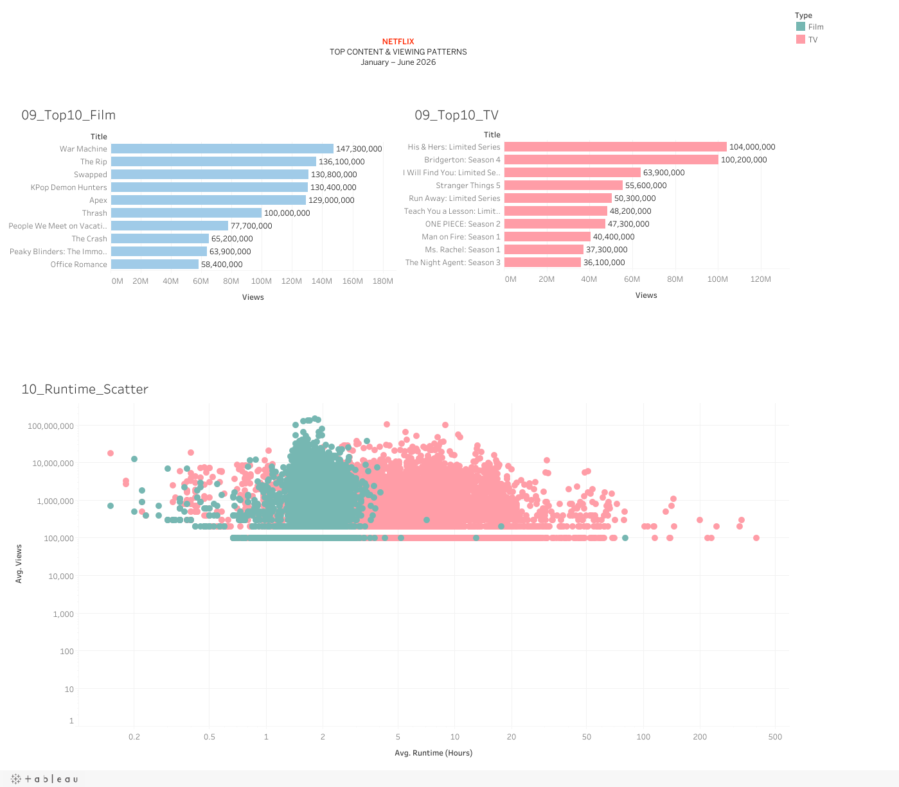

---

## 9. Source code ของโปรแกรม

Source code ฉบับเต็มอยู่ใน GitHub: **https://github.com/ainisthaa/DA_project** · หัวข้อ 9.5–9.6 ยกโค้ดส่วนสำคัญมาแสดงพร้อมคำอธิบาย

### 9.1 เทคโนโลยีที่ใช้

| ส่วน | เทคโนโลยี |
|---|---|
| Backend | Go 1.23+ (`net/http`), ไลบรารี `excelize` (อ่าน/เขียน Excel), `go-sql-driver/mysql` |
| ฐานข้อมูล | MySQL 8 (utf8mb4 รองรับชื่อเรื่องทุกภาษา) |
| Frontend | React 18 + Vite |
| คำนวณสูตร Excel อัตโนมัติ | LibreOffice Calc (headless) |
| เตรียมข้อมูล | Python 3 + openpyxl |
| รันทั้งระบบ | Docker Compose (MySQL + แอป) |
| กราฟ | Tableau Public |

### 9.2 โครงสร้างไฟล์

| ไฟล์ | หน้าที่ |
|---|---|
| `backend/main.go` | อ่านค่าตั้งค่า, เปิดฐานข้อมูล, เริ่มตัวซิงก์, เปิดเว็บเซิร์ฟเวอร์ |
| `backend/models.go` | โครงสร้างข้อมูล `Title` และการตรวจความถูกต้องของข้อมูล |
| `backend/db.go` | สร้างตาราง, เพิ่ม/แก้/ลบ/ค้นหาใน MySQL |
| `backend/excel.go` | อ่าน/เขียน `sheet1_RawData`, อ่านค่าที่คำนวณจาก `sheet4` |
| `backend/sync.go` | ซิงก์ Excel ↔ MySQL สองทาง และสั่ง LibreOffice คำนวณสูตรใหม่ |
| `backend/stats.go` | คำนวณสถิติชุดเดียวกับ sheet2 จากฐานข้อมูล (ใช้ตรวจเทียบกับ Excel) |
| `backend/handlers.go` | REST API ทั้งหมด |
| `backend/tableau.go` | ส่งไฟล์ Tableau และภาพ Dashboard ให้หน้าเว็บ |
| `frontend/src/App.jsx` | โครงหน้าเว็บและเมนู |
| `frontend/src/pages/*.jsx` | หน้า ภาพรวม / กราฟ Tableau / จัดการข้อมูล / ซิงก์ Excel / ตั้งค่า |
| `frontend/src/api.js` | ฟังก์ชันเรียก REST API |
| `scripts/build_excel.py` | สร้างไฟล์ Excel (4 sheet + สูตร) จากไฟล์ต้นฉบับของ Netflix |
| `Dockerfile`, `docker-compose.yml` | ตั้งค่าการรันทั้งระบบ |

### 9.3 REST API

| Method | Path | ใช้ทำ |
|---|---|---|
| GET | `/api/titles` | ค้นหา / กรอง / เรียง / แบ่งหน้า |
| POST / PUT / DELETE | `/api/titles`, `/api/titles/{id}` | เพิ่ม / แก้ / ลบ |
| GET | `/api/stats` | สถิติที่คำนวณจากฐานข้อมูล |
| GET | `/api/excel/summary` | ค่าที่ Excel คำนวณ (sheet4) |
| GET / POST | `/api/excel/download`, `/api/excel/upload` | ดาวน์โหลด / อัปโหลดไฟล์ Excel |
| GET / POST | `/api/sync/status`, `/api/sync/import`, `/api/sync/export` | สถานะและสั่งซิงก์ |
| GET / PUT | `/api/settings` | ลิงก์ Tableau ที่ฝังบนเว็บ |
| GET | `/api/tableau`, `/api/tableau/workbook`, `/api/tableau/images/{file}` | ไฟล์ Tableau และภาพ Dashboard |

### 9.4 การทำงานของการซิงก์ Excel ↔ ฐานข้อมูล

- **เว็บ → Excel**: บันทึกลง MySQL ทันที → รอ 0.5 วินาที (รวมหลายคำสั่ง) → เขียน `sheet1` ใหม่ทั้งแผ่นโดยไม่แตะ sheet อื่น → LibreOffice คำนวณสูตร sheet2–4 ใหม่
- **Excel → เว็บ**: ตรวจเวลาแก้ไขและขนาดไฟล์ทุก 3 วินาที ถ้าเปลี่ยน → อ่าน sheet1 → แถวที่มี ID = แก้, ไม่มี ID = เพิ่ม (แล้วเขียน ID กลับลง Excel), ID ที่หายไป = ลบ
- **กันข้อมูลหาย**: ถ้าไฟล์ Excel มีข้อมูลน้อยกว่าครึ่งของฐานข้อมูล จะไม่นำเข้าจนกว่าผู้ใช้จะกดยืนยัน · เขียนไฟล์ชั่วคราวก่อนแล้วค่อยแทนที่ ไฟล์จึงไม่เสียถ้าเขียนไม่จบ

### 9.5 โค้ดสำคัญ: การซิงก์ Excel ↔ ฐานข้อมูล

ส่วนนี้ทำให้ข้อมูลบนเว็บ ฐานข้อมูล MySQL และไฟล์ Excel ตรงกันเสมอ (โจทย์ข้อ 1–2) ลำดับการทำงานคือ
เว็บส่งข้อมูล → บันทึกลง MySQL → ตั้งธงว่า "ต้องเขียน Excel" → ตัวจับเวลาเบื้องหลังเขียน Excel → LibreOffice คำนวณสูตรใหม่
และในทางกลับกัน ตัวจับเวลาเดียวกันคอยดูว่าไฟล์ Excel ถูกแก้หรือไม่ ถ้าถูกแก้ก็ดึงเข้าฐานข้อมูล

**(1) รับข้อมูลจากหน้าเว็บ แล้วแจ้งว่าต้องเขียน Excel**

`backend/handlers.go` บรรทัด 101–115

```go
func (a *API) createTitle(w http.ResponseWriter, r *http.Request) {
	t, err := decodeTitle(r)
	if err != nil {
		writeErr(w, 400, err.Error())
		return
	}
	id, err := a.store.Create(t)
	if err != nil {
		writeErr(w, 500, err.Error())
		return
	}
	a.sync.RequestExport()
	saved, _ := a.store.Get(id)
	writeJSON(w, 201, saved)
}
```

`backend/sync.go` บรรทัด 158–165

```go
// RequestExport ถูกเรียกหลังเพิ่ม/แก้/ลบบนเว็บ
func (m *SyncManager) RequestExport() {
	_ = m.store.SetSetting("db_dirty", "1") // จำไว้ เผื่อโปรแกรมปิดก่อนเขียน Excel เสร็จ
	m.stMu.Lock()
	m.pending = true
	m.pendingAt = time.Now()
	m.stMu.Unlock()
}
```

- `decodeTitle` อ่าน JSON จากฟอร์มและตรวจความถูกต้อง (เช่น ชื่อห้ามว่าง, Runtime ต้องเป็น `H:MM`) ถ้าผิดตอบกลับรหัส 400 พร้อมข้อความภาษาไทย
- `store.Create` บันทึกลง MySQL แล้วได้ ID ใหม่กลับมา
- `RequestExport` **ยังไม่เขียน Excel ทันที** แค่ตั้งธง `pending` และเวลา เพื่อให้หน้าเว็บตอบกลับเร็ว และถ้าผู้ใช้แก้หลายรายการติดกันจะเขียนไฟล์ครั้งเดียว
- บันทึก `db_dirty = 1` ลงฐานข้อมูลไว้ด้วย ถ้าโปรแกรมถูกปิดก่อนเขียน Excel เสร็จ ตอนเปิดใหม่จะรู้ว่าต้องเขียนต่อ ข้อมูลจึงไม่หาย

**(2) ตัวจับเวลาเบื้องหลัง: เขียน Excel ที่ค้างอยู่ และคอยดูว่าไฟล์ Excel ถูกแก้หรือไม่**

`backend/sync.go` บรรทัด 122–156

```go
func (m *SyncManager) Run(ctx context.Context) {
	tick := time.NewTicker(500 * time.Millisecond)
	defer tick.Stop()
	lastPoll := time.Now()
	for {
		select {
		case <-ctx.Done():
			return
		case <-tick.C:
		}
		m.stMu.Lock()
		due := m.pending && time.Since(m.pendingAt) >= 500*time.Millisecond
		m.stMu.Unlock()
		if due {
			if err := m.Export("web"); err != nil {
				// ส่งออกไม่สำเร็จ (เช่นไฟล์ถูกล็อก) → ลองใหม่รอบหน้า
				m.stMu.Lock()
				m.pending = true
				m.pendingAt = time.Now().Add(10 * time.Second)
				m.stMu.Unlock()
			}
			continue
		}
		if time.Since(lastPoll) < m.interval {
			continue
		}
		lastPoll = time.Now()
		if m.changedOnDisk() {
			time.Sleep(time.Second) // รอให้โปรแกรมที่บันทึกไฟล์เขียนเสร็จ
			if _, err := m.Import(false, "excel-watch"); err != nil {
				log.Printf("watch import: %v", err)
			}
		}
	}
}
```

- ทำงานทุก 0.5 วินาทีตลอดเวลาที่โปรแกรมเปิดอยู่
- ถ้ามีงานค้าง (`pending`) และผ่านไปแล้ว 0.5 วินาที → เรียก `Export` เขียน Excel · ถ้าเขียนไม่ได้ (เช่นผู้ใช้เปิดไฟล์ค้างไว้ใน Excel บน Windows) จะลองใหม่ในอีก 10 วินาที
- ทุก 3 วินาที (`m.interval`) ตรวจว่าไฟล์ Excel เปลี่ยนหรือไม่ (`changedOnDisk` เทียบเวลาแก้ไขและขนาดไฟล์) ถ้าเปลี่ยน → รอ 1 วินาทีให้ Excel บันทึกเสร็จ แล้ว `Import` เข้าฐานข้อมูล

**(3) เขียนข้อมูลลง Excel และคำนวณสูตรใหม่**

`backend/sync.go` บรรทัด 269–298

```go
func (m *SyncManager) exportLocked(reason string) error {
	m.stMu.Lock()
	m.pending = false
	m.stMu.Unlock()
	titles, err := m.store.All()
	if err != nil {
		m.markPending()
		m.fail("export", reason, err)
		return err
	}
	if err := WriteExcel(m.path, titles); err != nil {
		m.markPending()
		m.fail("export", reason, err)
		return err
	}
	m.setStatus(func(s *SyncStatus) { s.LastExport, s.LastError = now(), "" })
	msg := fmt.Sprintf("DB → Excel (%s): เขียน %d แถวลง %s", reason, len(titles), SheetRaw)
	if m.recalc {
		if err := m.recalcExcel(); err != nil {
			msg += "\nคำนวณสูตรด้วย LibreOffice ไม่สำเร็จ: " + err.Error() + " (เปิดไฟล์ใน Excel แล้วสูตรจะคำนวณเอง)"
		} else {
			msg += " และคำนวณสูตร sheet2–4 ใหม่แล้ว"
			m.setStatus(func(s *SyncStatus) { s.LastRecalc = now() })
		}
	}
	m.rememberFile()
	_ = m.store.SetSetting("db_dirty", "0")
	m.store.AddLog("export", "ok", msg)
	return nil
}
```

- `store.All()` ดึงข้อมูลทั้งหมดจาก MySQL แล้ว `WriteExcel` เขียนทับ `sheet1_RawData` ทั้งแผ่น **โดยไม่แตะ sheet2–4** สูตรวิเคราะห์จึงยังอยู่ครบ
- `recalcExcel` สั่ง LibreOffice (ทำงานเบื้องหลังไม่มีหน้าจอ) เปิดไฟล์ คำนวณสูตรทั้งหมด แล้วบันทึกกลับ ค่าใน sheet2–4 ที่ Tableau และหน้าเว็บอ่านจึงเป็นค่าล่าสุดทันที
- `rememberFile` จำเวลาแก้ไขและขนาดไฟล์ที่โปรแกรมเขียนเอง เพื่อไม่ให้ตัวจับเวลาในข้อ (2) เข้าใจผิดว่าผู้ใช้แก้ไฟล์
- สุดท้ายตั้ง `db_dirty = 0` และบันทึกประวัติ ซึ่งแสดงในหน้า **ซิงก์ Excel**

**(4) ดึงข้อมูลที่แก้ใน Excel เข้าฐานข้อมูล พร้อมระบบกันข้อมูลหาย**

`backend/sync.go` บรรทัด 201–227

```go
func (m *SyncManager) importLocked(force bool, reason, src string) (ImportResult, error) {
	var res ImportResult
	if src == m.path {
		m.rememberFile()
	}
	rows, rowErrs, err := ReadExcel(src)
	if err != nil {
		m.fail("import", reason, err)
		return res, err
	}
	res.Rows, res.RowErrors = len(rows), rowErrs
	if res.RowErrors == nil {
		res.RowErrors = []RowError{}
	}
	dbCount, _ := m.store.Count()
	if !force && dbCount >= 100 && len(rows) < dbCount/2 {
		err := fmt.Errorf("ยกเลิกการนำเข้า: Excel มีข้อมูลที่ถูกต้อง %d แถว แต่ในฐานข้อมูลมี %d แถว (หายไปเกินครึ่ง) "+
			"— ถ้าตั้งใจลบจริง ให้กด \"นำเข้าจาก Excel (บังคับ)\" ในหน้าซิงก์ข้อมูล", len(rows), dbCount)
		m.fail("import", reason, err)
		return res, err
	}
	ins, upd, del, newIDs, err := m.store.ApplyExcel(rows)
	if err != nil {
		m.fail("import", reason, err)
		return res, err
	}
	res.Inserted, res.Updated, res.Deleted = ins, upd, del
	// ... (ส่วนบันทึกประวัติและเขียน ID กลับลง Excel ตัดออก)
```

- `ReadExcel` อ่าน `sheet1_RawData` โดยหาคอลัมน์จาก**ชื่อหัวคอลัมน์** (สลับลำดับคอลัมน์ได้) แถวที่ข้อมูลผิดจะถูกแยกไว้ใน `rowErrs` พร้อมเลขแถวและสาเหตุ ไม่ถูกนำเข้า
- **กันข้อมูลหาย:** ถ้าฐานข้อมูลมีอย่างน้อย 100 แถว แต่ Excel เหลือไม่ถึงครึ่ง (เช่นเผลอลบทั้งตาราง) จะยกเลิกการนำเข้าและแจ้งเตือน ผู้ใช้ต้องกด "นำเข้าแบบบังคับ" เองถ้าตั้งใจลบจริง
- `ApplyExcel` (ข้อ 5) เป็นตัวเปลี่ยนข้อมูลในฐานข้อมูลจริง

**(5) ตัดสินว่าแถวไหน เพิ่ม / แก้ / ลบ** (ส่วนหลักของฟังก์ชัน `ApplyExcel` — ด้านบนฟังก์ชันเปิด transaction และเตรียมคำสั่ง SQL `upStmt`, `insID`, `insAuto`)

`backend/db.go` บรรทัด 262–296

```go
	seen := map[int64]bool{}
	for _, t := range rows {
		if t.ID > 0 {
			seen[t.ID] = true
			if old, ok := byID[t.ID]; ok {
				if !sameTitle(old, t) {
					if _, err = upStmt.Exec(append(titleArgs(t), t.ID)...); err != nil {
						return
					}
					upd++
				}
				continue
			}
			if _, err = insID.Exec(append([]any{t.ID}, titleArgs(t)...)...); err != nil {
				return
			}
			ins++
			continue
		}
		if _, err = insAuto.Exec(titleArgs(t)...); err != nil {
			return
		}
		ins++
		newIDs = true
	}
	for id := range byID {
		if !seen[id] {
			if _, err = tx.Exec("DELETE FROM titles WHERE id=?", id); err != nil {
				return
			}
			del++
		}
	}
	err = tx.Commit()
	return
```

- ทั้งหมดทำใน **transaction** เดียว ถ้าผิดพลาดกลางทาง ฐานข้อมูลจะย้อนกลับทั้งหมด ไม่ค้างครึ่งๆ กลางๆ
- แถวที่ **มี ID และมีอยู่แล้ว** → ถ้าค่าต่างจากเดิม (`sameTitle`) ให้ `UPDATE` = แก้ไข
- แถวที่ **มี ID แต่ไม่มีในฐานข้อมูล** → `INSERT` พร้อม ID นั้น
- แถวที่ **ไม่มี ID** (ผู้ใช้พิมพ์แถวใหม่ใน Excel) → `INSERT` ให้ฐานข้อมูลสร้าง ID แล้วตั้ง `newIDs = true` เพื่อให้ระบบเขียน ID กลับลง Excel
- ID ที่อยู่ในฐานข้อมูลแต่ **ไม่อยู่ใน Excel แล้ว** (ไม่อยู่ใน `seen`) → `DELETE` = ผู้ใช้ลบแถวนั้นใน Excel

### 9.6 โค้ดสำคัญ: หน้าเว็บ

**(6) ฟอร์มเพิ่ม/แก้ไขข้อมูล**

`frontend/src/pages/DataTable.jsx` บรรทัด 132–155

```jsx
  async function submit(e) {
    e.preventDefault()
    setErr('')
    const hours = Number(String(f.hoursViewed).replace(/,/g, ''))
    const views = Number(String(f.views).replace(/,/g, ''))
    if (!f.title.trim()) return setErr('กรุณากรอกชื่อเรื่อง')
    if (!Number.isFinite(hours) || hours < 0 || String(f.hoursViewed).trim() === '') return setErr('Hours Viewed ต้องเป็นตัวเลขไม่ติดลบ')
    if (!Number.isFinite(views) || views < 0 || String(f.views).trim() === '') return setErr('Views ต้องเป็นตัวเลขไม่ติดลบ')
    if (f.runtime && !/^\d{1,3}:[0-5]\d$/.test(f.runtime.trim())) return setErr('Runtime ต้องเป็นรูปแบบ H:MM เช่น 1:45')
    const body = {
      type: f.type, title: f.title, availableGlobally: f.availableGlobally,
      releaseDate: f.releaseDate || null, hoursViewed: Math.round(hours),
      runtime: f.runtime.trim() || null, views: Math.round(views),
    }
    setSaving(true)
    try {
      const saved = isNew ? await api.createTitle(body) : await api.updateTitle(initial.id, body)
      onSaved(saved, isNew)
    } catch (e2) {
      setErr(e2.message)
    } finally {
      setSaving(false)
    }
  }
```

- ตรวจข้อมูลในเบราว์เซอร์ก่อนส่ง: ชื่อห้ามว่าง, Hours Viewed และ Views ต้องเป็นตัวเลขไม่ติดลบ (ลบเครื่องหมาย `,` ให้ก่อน จึงพิมพ์ `1,500,000` ได้), Runtime ต้องตรงรูปแบบ `H:MM` (ตรวจด้วย regular expression)
- `isNew` แยกว่าเป็นการเพิ่มใหม่ (`POST /api/titles`) หรือแก้ไข (`PUT /api/titles/{id}`) ใช้ฟอร์มเดียวกันทั้งสองแบบ
- ระหว่างบันทึก `saving = true` ปุ่มจะกดซ้ำไม่ได้ · ถ้า backend ตอบข้อผิดพลาด จะแสดงข้อความสีแดงในฟอร์ม
- เมื่อสำเร็จ `onSaved` ปิดฟอร์ม แสดงแถบสีเขียว และโหลดตารางใหม่

**(7) ลบข้อมูล**

`frontend/src/pages/DataTable.jsx` บรรทัด 33–42

```jsx
  async function onDelete(t) {
    if (!confirm(`ลบ "${t.title}" (ID ${t.id})?\nข้อมูลจะถูกลบจากฐานข้อมูลและไฟล์ Excel`)) return
    try {
      await api.deleteTitle(t.id)
      setMsg({ kind: 'ok', text: `ลบ "${t.title}" แล้ว — กำลังอัปเดตไฟล์ Excel` })
      setReload((r) => r + 1)
    } catch (e) {
      setMsg({ kind: 'bad', text: e.message })
    }
  }
```

- ถามยืนยันก่อนลบเสมอ (`confirm`) แล้วเรียก `DELETE /api/titles/{id}` ฝั่ง backend ลบจาก MySQL และตั้งธงให้เขียน Excel ใหม่แบบเดียวกับข้อ (1)
- `setReload` เพิ่มค่าเพื่อสั่งให้ตารางโหลดข้อมูลใหม่

**(8) ฝังกราฟ Tableau บนหน้าเว็บ (โจทย์ข้อ 5)**

`frontend/src/pages/Charts.jsx` บรรทัด 6–20

```jsx
export function embedUrl(raw) {
  try {
    const u = new URL(raw)
    if (u.hostname.includes('tableau.com')) {
      // ลิงก์แชร์มักมี ?:language=...&:display_count=...&:origin=viz_share_link
      u.searchParams.set(':embed', 'y')
      u.searchParams.set(':showVizHome', 'no')
      u.searchParams.set(':toolbar', 'yes')
      u.searchParams.delete(':origin')
    }
    return u.toString()
  } catch {
    return raw
  }
}
```

`frontend/src/pages/Charts.jsx` บรรทัด 30–41

```jsx
  useEffect(() => {
    Promise.all([
      api.getSettings().then((s) => s.tableauViews).catch(() => []),
      api.tableau().catch(() => ({ workbook: null, images: [] })),
    ]).then(([views, tb]) => {
      setWorkbook(tb.workbook)
      setTabs([
        ...views.map((v) => ({ kind: 'live', name: v.name, url: v.url })),
        ...tb.images.map((img) => ({ kind: 'image', name: img.name, url: img.url })),
      ])
    })
  }, [])
```

`frontend/src/pages/Charts.jsx` บรรทัด 82–90

```jsx
        {v.kind === 'live' ? (
          <div className="tableau-frame">
            <iframe key={v.url} title={v.name} src={embedUrl(v.url)} allowFullScreen loading="lazy" />
          </div>
        ) : (
          <div className="tableau-image">
            
          </div>
        )}
```

- `embedUrl` แปลงลิงก์แชร์ของ Tableau Public ให้เป็นลิงก์สำหรับฝัง (เพิ่ม `:embed=y`, ซ่อนหน้า Tableau Public รอบนอก)
- ตอนเปิดหน้า ดึงข้อมูล 2 แหล่งพร้อมกัน (`Promise.all`): ลิงก์ Tableau Public จากหน้าตั้งค่า และรายการภาพ Dashboard ในโฟลเดอร์ `data/tableau/` แล้วรวมเป็นแท็บ
- แท็บแบบ `live` แสดงด้วย `<iframe>` (โต้ตอบได้ ต้องมีอินเทอร์เน็ต) ส่วนแท็บแบบ `image` แสดงด้วย `` (ใช้ได้แม้ออฟไลน์) ถ้าโหลดแหล่งใดไม่ได้ (`catch`) หน้าก็ยังแสดงแหล่งที่เหลือได้

---

## 10. ลำดับขั้นตอนสาธิต (สำหรับนำเสนอ)

ทำตามนี้เพื่อแสดงให้เห็นว่าข้อมูลไหลครบทุกส่วน

| ขั้น | ทำอะไร | สิ่งที่ต้องเห็น |
|---|---|---|
| 1 | เปิดหน้า **ภาพรวม** | 17,370 เรื่อง, แถบเขียว "ตรงกับฐานข้อมูล" |
| 2 | เปิดไฟล์ Excel ดู sheet2 | ค่าเดียวกับบนเว็บ |
| 3 | หน้า **จัดการข้อมูล** → เพิ่มเรื่องใหม่ ยอดดู 200,000,000 | แถบเขียว "เพิ่มแล้ว" |
| 4 | กลับหน้า **ภาพรวม** | จำนวนเรื่อง +1, เรื่องใหม่ขึ้น Top 10 |
| 5 | เปิด Excel (ปิดแล้วเปิดใหม่) | แถวใหม่อยู่ท้าย sheet1, sheet3 Top 10 มีเรื่องใหม่ |
| 6 | ใน Excel แก้ Views ของเรื่องนั้น → Save → ปิดไฟล์ | ภายใน 3 วินาที หน้าเว็บแสดงค่าใหม่ |
| 7 | หน้า **ซิงก์ Excel** | ประวัติแสดงทั้งสองทิศทาง |
| 8 | เปิด `tableau_netflix2.twbx` → **Data → Refresh All Extracts** → **File → Save to Tableau Public** (ทับชื่อเดิม) | หน้า **กราฟ Tableau** แสดงกราฟที่อัปเดต (เช่น Top 10 Film มีเรื่องใหม่) |
| 9 | ลบเรื่องทดสอบบนเว็บ | กลับเป็น 17,370 ทั้งเว็บและ Excel |

---

## 11. ปัญหาที่พบบ่อย

| อาการ | สาเหตุ / วิธีแก้ |
|---|---|
| ป้ายแดง "ติดต่อ backend ไม่ได้" | backend ไม่ได้รัน → ตรวจ Terminal ที่รัน `docker compose up` |
| ป้ายแดง "ซิงก์มีปัญหา" ข้อความ "บันทึกไฟล์ Excel ไม่ได้" | ไฟล์ถูกเปิดค้างใน Excel → ปิด Excel ระบบจะเขียนให้เองภายใน 10 วินาที |
| แก้ Excel แล้วเว็บไม่เปลี่ยน | ดูหน้าซิงก์: ถ้ามี "ยกเลิกการนำเข้า" แปลว่าข้อมูลหายเกินครึ่ง, ถ้ามี "แถวที่นำเข้าไม่ได้" ให้แก้ตามสาเหตุ |
| แถบเหลือง "Excel ยังคำนวณสูตรไม่เสร็จ" | รอ 5–10 วินาที (ระบบกำลังคำนวณ) หรือถ้ารันแบบไม่มี LibreOffice ให้เปิดไฟล์ใน Excel แล้ว Save |
| หน้ากราฟ Tableau ว่าง | ตรวจว่า viz บน Tableau Public ตั้งเป็น Public และลิงก์ถูกต้อง หรือดูแท็บ (ภาพ) ที่ใช้ได้แม้ไม่มีอินเทอร์เน็ต |
| Publish ไม่ได้: "Missing connection name in relation / Unable to create extract" | มี data source ที่ไม่ได้ใช้และไฟล์ extract หายไป → แถบ Data คลิกขวา data source ที่ไม่มีวงเล็บ `netflix_data` → Close → Save แล้ว publish ใหม่ |
| ไม่มีแท็บภาพ Dashboard | ไฟล์ต้องเป็น .png/.jpg อยู่ใน `data/tableau/` โดยตรง (ไม่ใช่โฟลเดอร์ย่อย) แล้วรีเฟรชหน้าเว็บ |
| เปิด tableau_netflix2 บนเครื่องอื่นแล้วถามหาไฟล์ Excel | ไฟล์ .twbx เก็บสำเนาข้อมูล (extract) ไว้ในไฟล์แล้ว ใช้ดูได้เลย ถ้าจะ Refresh ให้ชี้ไปที่ `data/netflix_data.xlsx` ของเครื่องนั้น (Data → Edit Data Source) |
| พอร์ต 8080 หรือ 3308 ถูกใช้ (`port is already allocated`) | ปิดโปรแกรมที่ใช้พอร์ตนั้น หรือแก้เลขพอร์ตฝั่งซ้ายใน `docker-compose.yml` (เช่น `"3309:3306"`) — พอร์ต MySQL ฝั่งเครื่องใช้แค่ต่อ Workbench ไม่กระทบเว็บ |
| อยากเริ่มฐานข้อมูลใหม่ทั้งหมด | `docker compose down -v` แล้ว `docker compose up --build` (ระบบจะนำเข้าจาก Excel ใหม่) |

---

**ที่มาข้อมูล** (รายละเอียดในหัวข้อ 2): Netflix. (2026, July 16). *What We Watched: A Netflix Engagement Report (January–June 2026)*.
https://about.netflix.com/en/news/what-we-watched-the-first-half-of-2026
