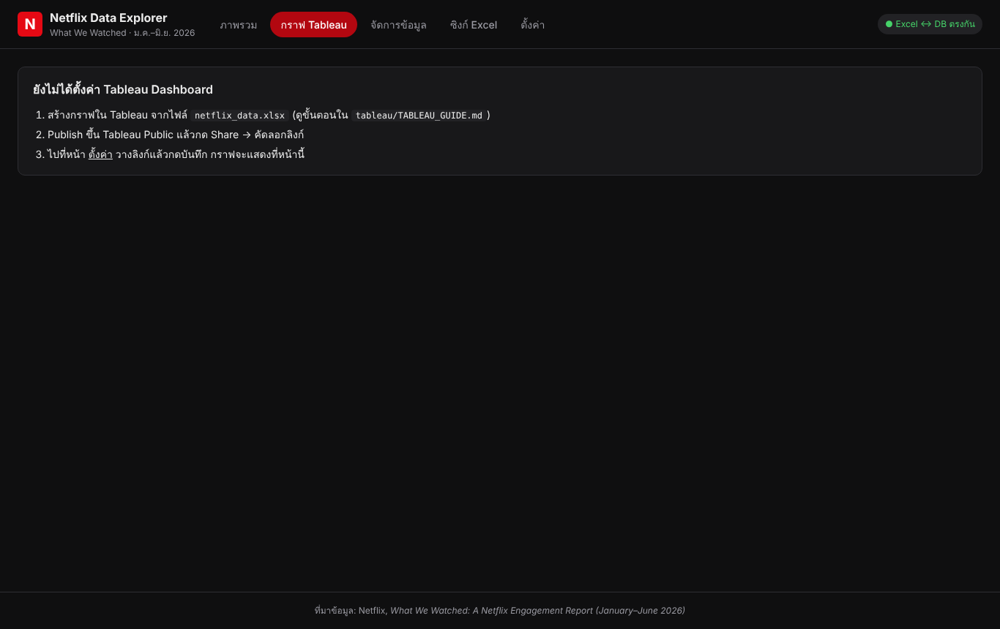

# คู่มือการใช้งาน — Netflix Data Explorer

ระบบจัดการและวิเคราะห์ข้อมูลยอดดู Netflix (What We Watched, ม.ค.–มิ.ย. 2026)
ข้อมูลไหลครบวงจร: **หน้าเว็บ ↔ MySQL ↔ Excel → Tableau → หน้าเว็บ**

> ภาพหน้าจอทั้งหมดในคู่มือนี้ถ่ายจากระบบจริง (ไฟล์อยู่ใน `docs/images/`)

---

## สารบัญ

1. ภาพรวมระบบ
2. ติดตั้งและเปิดโปรแกรม
3. หน้าภาพรวม (ค่าที่คำนวณได้)
4. จัดการข้อมูล: ค้นหา / เพิ่ม / แก้ไข / ลบ
5. แก้ข้อมูลในไฟล์ Excel โดยตรง
6. หน้าซิงก์ Excel
7. ทำกราฟใน Tableau และแสดงบนเว็บ
8. ลำดับขั้นตอนสาธิต (สำหรับนำเสนอ)
9. ปัญหาที่พบบ่อย

---

## 1. ภาพรวมระบบ

ข้อมูลไหลตามลำดับนี้

| ขั้น | จาก | ไปที่ | เกิดอะไรขึ้น |
|---|---|---|---|
| 1 | หน้าเว็บ (React) | Backend Go + MySQL | ผู้ใช้เพิ่ม / แก้ / ลบข้อมูล → บันทึกลงตาราง `titles` |
| 2 | Backend Go | Excel `netflix_data.xlsx` | เขียน sheet1 (ข้อมูลดิบ) ใหม่ แล้วให้ Excel คำนวณสูตร sheet2–4 ใหม่ |
| 3 | Excel | Backend Go + MySQL | ถ้าแก้ไฟล์ Excel โดยตรง ระบบตรวจไฟล์ทุก 3 วินาที แล้วนำเข้าฐานข้อมูล |
| 4 | Excel (sheet1 + sheet4) | Tableau | Tableau อ่านข้อมูลดิบและค่าที่ Excel คำนวณ มาทำกราฟ → publish ขึ้น Tableau Public |
| 5 | Tableau Public | หน้าเว็บ | ฝัง Dashboard ในเมนู **กราฟ Tableau** (และภาพนิ่งสำรอง) |
| 6 | Backend Go | หน้าเว็บ | แสดงข้อมูลและค่าที่คำนวณได้ในเมนู **ภาพรวม** |

ไฟล์ Excel มี 4 sheet: **sheet1** ข้อมูลดิบ · **sheet2** วิเคราะห์ด้วยสูตร · **sheet3** Top 10 · **sheet4** สรุปสำหรับ Tableau

| ส่วนประกอบ | หน้าที่ |
|---|---|
| หน้าเว็บ (React) | ป้อน/แก้/ลบข้อมูล, แสดงค่าที่คำนวณได้, ฝังกราฟ Tableau, ซิงก์ไฟล์ |
| Backend (Go) | REST API, บันทึกลง MySQL, ซิงก์กับ Excel สองทาง |
| MySQL | ฐานข้อมูลหลัก ตาราง `titles` |
| Excel | ข้อมูลดิบ + วิเคราะห์ด้วยสูตร (ค่าเฉลี่ย, มัธยฐาน, %, Top 10, Pareto) |
| Tableau | ทำกราฟจากข้อมูลดิบและค่าที่ Excel คำนวณ |

---

## 2. ติดตั้งและเปิดโปรแกรม

### วิธีที่ 1: Docker (แนะนำ — คำสั่งเดียวได้ทั้งระบบ)

1. ติดตั้ง **Docker Desktop**: https://www.docker.com/products/docker-desktop/ แล้วเปิดโปรแกรมทิ้งไว้
2. เปิด Terminal (Windows: PowerShell) ที่โฟลเดอร์โปรเจกต์ แล้วรัน
   ```
   docker compose up --build
   ```
   ครั้งแรกใช้เวลา 3–10 นาที (ดาวน์โหลด MySQL, Go, Node, LibreOffice)
3. เมื่อเห็นข้อความ `เปิดเว็บที่ http://localhost:8080` ให้เปิดเบราว์เซอร์ไปที่ **http://localhost:8080**
4. ปิดระบบ: กด `Ctrl + C` ใน Terminal (หรือ `docker compose down`)

ไฟล์ Excel ที่ระบบใช้คือ `data/netflix_data.xlsx` ในโฟลเดอร์โปรเจกต์ เปิดด้วย Excel ได้ตามปกติ

### วิธีที่ 2: รันเองโดยไม่ใช้ Docker

ต้องมี: MySQL 8, Go 1.23+, Node.js 20+ (และ LibreOffice ถ้าต้องการให้คำนวณสูตรอัตโนมัติ)

1. สร้างฐานข้อมูลใน MySQL
   ```sql
   CREATE DATABASE netflix CHARACTER SET utf8mb4;
   CREATE USER 'netflix'@'localhost' IDENTIFIED BY 'netflix';
   GRANT ALL ON netflix.* TO 'netflix'@'localhost';
   ```
2. Build หน้าเว็บ
   ```
   cd frontend
   npm install
   npm run build
   ```
3. รัน backend (Windows PowerShell)
   ```
   cd backend
   go mod tidy
   $env:STATIC_DIR="../frontend/dist"; $env:EXCEL_PATH="../data/netflix_data.xlsx"; go run .
   ```
   macOS/Linux: `STATIC_DIR=../frontend/dist EXCEL_PATH=../data/netflix_data.xlsx go run .`
4. เปิด http://localhost:8080

ตัวแปรที่ตั้งได้: `DB_DSN` (ค่าเริ่มต้น `netflix:netflix@tcp(127.0.0.1:3306)/netflix?charset=utf8mb4`), `PORT`, `POLL_SECONDS`,
`RECALC` (`auto`/`true`/`false`), `SOFFICE_PATH` (เช่น `C:\Program Files\LibreOffice\program\soffice.exe`)

> ครั้งแรกที่เปิด ระบบจะนำเข้าข้อมูล 17,370 แถวจาก Excel ลง MySQL ให้อัตโนมัติ

---

## 3. หน้าภาพรวม (ค่าที่คำนวณได้)

เมนู **ภาพรวม** แสดงผลวิเคราะห์ชุดเดียวกับ `sheet2_Analysis` ใน Excel


| ส่วน | ความหมาย |
|---|---|
| แถบสีเขียวด้านบน | ยืนยันว่าค่าที่ Excel คำนวณ (sheet2–4) ตรงกับฐานข้อมูล ถ้าเป็นสีเหลือง = Excel กำลังคำนวณใหม่ |
| การ์ด KPI 4 ใบ | จำนวนเรื่อง, ชั่วโมงดูรวม, ยอดดูรวม, ยอดดูเฉลี่ย/มัธยฐาน |
| TV กับ Film | จำนวน, ชั่วโมงดู, % ชั่วโมงดู, ยอดดูเฉลี่ย/มัธยฐาน/สูงสุด, Runtime เฉลี่ย |
| Netflix Title กับ Non-Netflix | แยกตามว่ามี Release Date หรือไม่ |
| ฉายทั่วโลก | เปรียบเทียบ Available Globally Yes/No |
| ความยาวกับยอดดู | ยอดดูเฉลี่ยตามช่วงความยาว |
| ปีที่ออกฉาย | จำนวนเรื่องและชั่วโมงดูของ Netflix Title แต่ละปี |
| Pareto | เรื่องท็อป X% ครองชั่วโมงดูกี่ % |
| Top 10 Film / TV | 10 อันดับยอดดูสูงสุด |

ค่าบนหน้านี้อัปเดตเองทุกครั้งที่ข้อมูลเปลี่ยน (ไม่ต้องกดรีเฟรช)

---

## 4. จัดการข้อมูล: ค้นหา / เพิ่ม / แก้ไข / ลบ

### 4.1 ดูและค้นหาข้อมูล

เมนู **จัดการข้อมูล** แสดงตารางข้อมูลทั้งหมด ครั้งละ 25 แถว


- **ช่องค้นหา**: พิมพ์บางส่วนของชื่อเรื่อง ผลจะกรองทันที
- **ตัวกรอง**: ประเภท (TV/Film), พื้นที่ฉาย, แหล่ง (Netflix Title/Non-Netflix)
- **เรียงลำดับ**: ยอดดู, ชั่วโมงดู, วันที่ออกฉาย, ชื่อ, แก้ไขล่าสุด
- ปุ่ม « ‹ › » ด้านล่างใช้เปลี่ยนหน้า

ตัวอย่างค้นหาคำว่า `Squid Game`:


### 4.2 เพิ่มข้อมูลใหม่

1. กดปุ่ม **+ เพิ่มข้อมูล** (มุมขวาบน)
2. กรอกข้อมูล (ช่องที่มี * ต้องกรอก)
   - **Title**: ชื่อเรื่อง
   - **Type**: TV หรือ Film
   - **Available Globally**: Yes / No
   - **Release Date**: วันที่ออกฉาย (ปล่อยว่างได้ถ้าไม่ใช่คอนเทนต์ของ Netflix)
   - **Runtime**: ความยาวรูปแบบ `ชั่วโมง:นาที` เช่น `1:45`
   - **Hours Viewed**, **Views**: ตัวเลข
3. กด **บันทึก**


ระบบจะ: บันทึกลง MySQL → แจ้งผลเป็นแถบสีเขียว → เขียนแถวใหม่ลง `sheet1_RawData` ใน Excel → คำนวณสูตรใหม่
(คอลัมน์ `Runtime (ชม.)` คำนวณให้อัตโนมัติ)


ถ้ากรอกผิด เช่น ไม่ใส่ชื่อ หรือ Runtime ไม่ใช่รูปแบบ H:MM ระบบจะแจ้งเตือนสีแดงและยังไม่บันทึก

### 4.3 แก้ไขข้อมูล

1. กดปุ่ม **แก้ไข** ท้ายแถวที่ต้องการ
2. แก้ค่าในฟอร์ม แล้วกด **บันทึก**


### 4.4 ลบข้อมูล

1. กดปุ่ม **ลบ** ท้ายแถว
2. กด **OK** ในกล่องยืนยัน → แถวถูกลบจากทั้ง MySQL และ Excel


---

## 5. แก้ข้อมูลในไฟล์ Excel โดยตรง

นอกจากหน้าเว็บ สามารถแก้ใน Excel ได้เลย ระบบจะดึงเข้าฐานข้อมูลเอง

1. เปิด `data/netflix_data.xlsx` ด้วย Microsoft Excel
2. ไปที่ sheet **`sheet1_RawData`** แล้ว
   - **แก้ค่า**: แก้ในช่องได้เลย (ห้ามแก้คอลัมน์ `ID`)
   - **เพิ่มแถว**: พิมพ์ต่อท้ายตาราง **ปล่อย `ID` ว่าง** — ระบบจะใส่ ID ให้
   - **ลบแถว**: คลิกขวาที่เลขแถว → Delete
3. กด **Save** (Ctrl + S) → ภายใน 3 วินาทีฐานข้อมูลและหน้าเว็บจะอัปเดต
4. **ปิดไฟล์ Excel** เมื่อแก้เสร็จ (บน Windows ถ้าเปิดไฟล์ค้างไว้ ระบบจะเขียนไฟล์ไม่ได้จนกว่าจะปิด — ระบบจะลองใหม่ให้เอง)

กฎของแต่ละคอลัมน์

| คอลัมน์ | ค่าที่ใส่ได้ |
|---|---|
| ID | ปล่อยว่างสำหรับแถวใหม่ (ห้ามซ้ำ) |
| Type | `TV` หรือ `Film` |
| Title | ข้อความ ห้ามว่าง |
| Available Globally | `Yes` หรือ `No` |
| Release Date | วันที่ หรือว่าง |
| Hours Viewed, Views | ตัวเลข ≥ 0 |
| Runtime | `H:MM` เช่น `1:45` หรือว่าง |
| Runtime (Hours) | ไม่ต้องกรอก ระบบคำนวณเอง |

sheet อื่นๆ ใน Excel

| Sheet | ใช้ทำอะไร |
|---|---|
| `sheet2_Analysis` | ผลวิเคราะห์ 7 หัวข้อด้วยสูตร Excel (COUNTIF, SUMIF, AVERAGEIF, MEDIAN, LARGE ฯลฯ) — อัปเดตเองเมื่อข้อมูลเปลี่ยน |
| `sheet3_Top10` | Top 10 Film และ TV ด้วยสูตร |
| `sheet4_TableauSummary` | ค่าจาก sheet2–3 ในรูปตารางสำหรับ Tableau |

> **ระบบกันข้อมูลหาย**: ถ้าบันทึกไฟล์ที่ข้อมูลหายไปเกินครึ่ง (เช่นเผลอลบทั้งตาราง) ระบบจะ**ไม่**นำเข้า และแจ้งเตือนในหน้าซิงก์
> แถวที่ข้อมูลผิดรูปแบบจะไม่ถูกนำเข้า และแสดงเลขแถว + สาเหตุในหน้าซิงก์

---

## 6. หน้าซิงก์ Excel

เมนู **ซิงก์ Excel** ใช้ดูสถานะการเชื่อม Excel กับ MySQL และสั่งงานด้วยมือ


| ปุ่ม | ทำอะไร |
|---|---|
| ⬇ ดาวน์โหลดไฟล์ Excel | ดาวน์โหลดไฟล์ล่าสุด (มีครบ 4 sheet) |
| ⬆ อัปโหลดไฟล์ Excel ที่แก้แล้ว | นำเข้าข้อมูลจาก sheet1 ของไฟล์ที่อัปโหลด (sheet วิเคราะห์ของไฟล์หลักยังอยู่ครบ) |
| Excel → ฐานข้อมูล | ดึงข้อมูลจาก Excel เข้า MySQL ทันที |
| ฐานข้อมูล → Excel | เขียนข้อมูลจาก MySQL ลง Excel ทันที |
| นำเข้าจาก Excel (บังคับ) | ใช้เมื่อตั้งใจลบข้อมูลจำนวนมากใน Excel จริงๆ |

ป้ายมุมขวาบนของทุกหน้าบอกสถานะ: 🟢 ตรงกัน · 🟡 กำลังเขียน Excel · 🔴 มีปัญหา (กดเพื่อดูรายละเอียด)

ตาราง **ประวัติการซิงก์** บันทึกทุกครั้งที่ข้อมูลเคลื่อนระหว่าง Excel กับฐานข้อมูล พร้อมจำนวนแถวที่เพิ่ม/แก้/ลบ

---

## 7. ทำกราฟใน Tableau และแสดงบนเว็บ

ไฟล์ Tableau ของโปรเจกต์คือ **`data/tableau_netflix2.twbx`** (ขั้นตอนทำกราฟละเอียดอยู่ใน `tableau/TABLEAU_GUIDE.md`)

**tableau_netflix2 ประกอบด้วย**

| Dashboard | Worksheet | แหล่งข้อมูล |
|---|---|---|
| `Dashboard_Overview` | 01_KPI, 02_TV_Film_Share, 03_AVG_MED, 04_Origin_AvgViews, 04_Origin_HoursShare, 05_Global_AvgViews, 05_Global_HoursShare, 06_Runtime_Views, 07_Release_Year, 07_Release_Year_Titles, 08_Pareto | `sheet4_TableauSummary` (ค่าที่ Excel คำนวณใน sheet2–3) |
| `Dashboard_Details` | 09_Top10_Film, 09_Top10_TV, 10_Runtime_Scatter | `sheet1_RawData` (ข้อมูลดิบ) |

**นำกราฟไปแสดงบนเว็บ (เมนู กราฟ Tableau) ได้ 2 วิธี — ทำได้ทั้งสองอย่างพร้อมกัน**

Dashboard publish ขึ้น Tableau Public แล้ว และหน้าเว็บตั้งค่าไว้ให้แล้ว เปิดเมนู **กราฟ Tableau** จะเห็น 4 แท็บ:

| แท็บ | แสดงอะไร | ต้องมีอินเทอร์เน็ต |
|---|---|---|
| ภาพรวม (Tableau) | Dashboard_Overview แบบโต้ตอบได้ (ชี้เมาส์ดูค่า, คลิกกรอง) | ใช่ |
| Top 10 และ Runtime (Tableau) | Dashboard_Details แบบโต้ตอบได้ | ใช่ |
| Dashboard Overview (ภาพ) | ภาพนิ่งจาก `data/tableau/01_Dashboard_Overview.png` | ไม่ |
| Dashboard Details (ภาพ) | ภาพนิ่งจาก `data/tableau/02_Dashboard_Details.png` | ไม่ |

ลิงก์ที่ publish ไว้:
- https://public.tableau.com/views/tableau_netflix2/Dashboard_Overview
- https://public.tableau.com/views/tableau_netflix2/Dashboard_Details

**เพิ่ม/เปลี่ยนลิงก์:** เมนู **ตั้งค่า** → **+ เพิ่มลิงก์** → ใส่ชื่อแท็บและวางลิงก์จากปุ่ม **Share** ของ Tableau Public → **บันทึก**


**อัปเดตภาพนิ่งเมื่อข้อมูลเปลี่ยน:** Tableau Public ไม่มีเมนู Export Image → หลัง Save to Tableau Public แล้ว
เปิด `https://public.tableau.com/views/tableau_netflix2/Dashboard_Overview.png?:display_static_image=y` ในเบราว์เซอร์ → บันทึกภาพทับ `data/tableau/01_Dashboard_Overview.png`
(ทำแบบเดียวกันกับ `Dashboard_Details` → `02_Dashboard_Details.png`)

หน้ากราฟมีปุ่ม **ดาวน์โหลด tableau_netflix2.twbx** ให้ผู้ใช้โหลดไฟล์ Tableau ไปเปิดเองได้

ถ้ายังไม่มีทั้งภาพและลิงก์ หน้ากราฟจะแสดงขั้นตอนแนะนำ:



หน้า **กราฟ Tableau** บนเว็บ แท็บ "ภาพรวม (Tableau)" ฝัง Dashboard จาก Tableau Public (เลื่อนดู / ชี้เมาส์ดูค่า / สลับ sheet ด้านบนได้):


แท็บ "Dashboard Overview (ภาพ)" แสดงภาพนิ่ง ใช้ได้แม้ไม่มีอินเทอร์เน็ต:


**Dashboard_Overview** (tableau_netflix2) — KPI, สัดส่วน TV/Film, ค่าเฉลี่ย vs มัธยฐาน, Netflix Title vs Non-Netflix, ฉายทั่วโลก, ความยาว, ปีที่ออกฉาย, Pareto
(ข้อมูลจาก `sheet4_TableauSummary` = ค่าที่ Excel คำนวณใน sheet2–3)


**Dashboard_Details** (tableau_netflix2) — Top 10 Film, Top 10 TV, Runtime กับยอดดู (scatter)
(ข้อมูลจาก `sheet1_RawData`)


---

## 8. ลำดับขั้นตอนสาธิต (สำหรับนำเสนอ)

ทำตามนี้เพื่อแสดงให้เห็นว่าข้อมูลไหลครบทุกส่วน

| ขั้น | ทำอะไร | สิ่งที่ต้องเห็น |
|---|---|---|
| 1 | เปิดหน้า **ภาพรวม** | 17,370 เรื่อง, แถบเขียว "ตรงกับฐานข้อมูล" |
| 2 | เปิดไฟล์ Excel ดู sheet2 | ค่าเดียวกับบนเว็บ |
| 3 | หน้า **จัดการข้อมูล** → เพิ่มเรื่องใหม่ ยอดดู 200,000,000 | แถบเขียว "เพิ่มแล้ว" |
| 4 | กลับหน้า **ภาพรวม** | จำนวนเรื่อง +1, เรื่องใหม่ขึ้น Top 10 |
| 5 | เปิด Excel (ปิดแล้วเปิดใหม่) | แถวใหม่อยู่ท้าย sheet1, sheet3 Top 10 มีเรื่องใหม่ |
| 6 | ใน Excel แก้ Views ของเรื่องนั้น → Save → ปิดไฟล์ | ภายใน 3 วินาที หน้าเว็บแสดงค่าใหม่ |
| 7 | หน้า **ซิงก์ Excel** | ประวัติแสดงทั้งสองทิศทาง |
| 8 | เปิด `tableau_netflix2.twbx` → **Data → Refresh All Extracts** → **File → Save to Tableau Public** (ทับชื่อเดิม) | หน้า **กราฟ Tableau** แสดงกราฟที่อัปเดต (เช่น Top 10 Film มีเรื่องใหม่) |
| 9 | ลบเรื่องทดสอบบนเว็บ | กลับเป็น 17,370 ทั้งเว็บและ Excel |

---

## 9. ปัญหาที่พบบ่อย

| อาการ | สาเหตุ / วิธีแก้ |
|---|---|
| ป้ายแดง "ติดต่อ backend ไม่ได้" | backend ไม่ได้รัน → ตรวจ Terminal ที่รัน `docker compose up` |
| ป้ายแดง "ซิงก์มีปัญหา" ข้อความ "บันทึกไฟล์ Excel ไม่ได้" | ไฟล์ถูกเปิดค้างใน Excel → ปิด Excel ระบบจะเขียนให้เองภายใน 10 วินาที |
| แก้ Excel แล้วเว็บไม่เปลี่ยน | ดูหน้าซิงก์: ถ้ามี "ยกเลิกการนำเข้า" แปลว่าข้อมูลหายเกินครึ่ง, ถ้ามี "แถวที่นำเข้าไม่ได้" ให้แก้ตามสาเหตุ |
| แถบเหลือง "Excel ยังคำนวณสูตรไม่เสร็จ" | รอ 5–10 วินาที (ระบบกำลังคำนวณ) หรือถ้ารันแบบไม่มี LibreOffice ให้เปิดไฟล์ใน Excel แล้ว Save |
| หน้ากราฟ Tableau ว่าง | ตรวจว่า viz บน Tableau Public ตั้งเป็น Public และลิงก์ถูกต้อง หรือดูแท็บ (ภาพ) ที่ใช้ได้แม้ไม่มีอินเทอร์เน็ต |
| Publish ไม่ได้: "Missing connection name in relation / Unable to create extract" | มี data source ที่ไม่ได้ใช้และไฟล์ extract หายไป → แถบ Data คลิกขวา data source ที่ไม่มีวงเล็บ `netflix_data` → Close → Save แล้ว publish ใหม่ |
| ไม่มีแท็บภาพ Dashboard | ไฟล์ต้องเป็น .png/.jpg อยู่ใน `data/tableau/` โดยตรง (ไม่ใช่โฟลเดอร์ย่อย) แล้วรีเฟรชหน้าเว็บ |
| เปิด tableau_netflix2 บนเครื่องอื่นแล้วถามหาไฟล์ Excel | ไฟล์ .twbx เก็บสำเนาข้อมูล (extract) ไว้ในไฟล์แล้ว ใช้ดูได้เลย ถ้าจะ Refresh ให้ชี้ไปที่ `data/netflix_data.xlsx` ของเครื่องนั้น (Data → Edit Data Source) |
| พอร์ต 8080 หรือ 3308 ถูกใช้ (`port is already allocated`) | ปิดโปรแกรมที่ใช้พอร์ตนั้น หรือแก้เลขพอร์ตฝั่งซ้ายใน `docker-compose.yml` (เช่น `"3309:3306"`) — พอร์ต MySQL ฝั่งเครื่องใช้แค่ต่อ Workbench ไม่กระทบเว็บ |
| อยากเริ่มฐานข้อมูลใหม่ทั้งหมด | `docker compose down -v` แล้ว `docker compose up --build` (ระบบจะนำเข้าจาก Excel ใหม่) |

---

**ที่มาข้อมูล:** Netflix. (2026, July 16). *What We Watched: A Netflix Engagement Report (January–June 2026)*.
https://about.netflix.com/en/news/what-we-watched-the-first-half-of-2026
